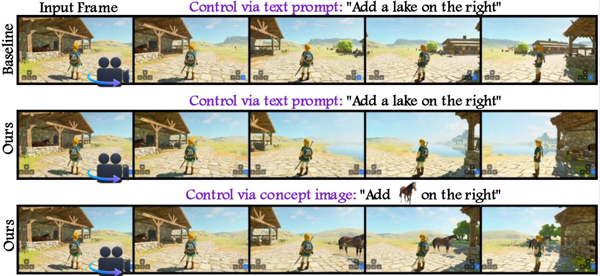

# From Zero to Hero: Training-Free Custom Concept Spawning in Interactive World Models (NeurIPS 2026)

Official implementation of **SPAWN** (**S**wapping **P**inned **A**nchor with **W**indowed i**N**jection), a
training-free method for spawning custom concepts into interactive autoregressive video world models.

[](https://arxiv.org/abs/2606.02575)
[](https://spawn-world.github.io/)



## Abstract

Autoregressive world models have emerged as a powerful paradigm for interactive video generation,
allowing users to navigate dynamically generated environments through actions. These models are
typically conditioned on a text prompt and/or a single reference frame, from which the entire world
is generated. Yet the moment the user navigates beyond what is visible in that frame, the unseen
regions are populated by the base model's priors, with no mechanism for the user to specify what
should appear and where. This is a fundamental limitation for applications such as gaming,
interactive storytelling, and simulation, where controllable scene composition is essential. We
refer to this missing capability as *concept spawning*: introducing a user-specified visual concept
into a world model, analogous to spawning in a game engine. We introduce **SPAWN**
(**S**wapping **P**inned **A**nchor with **W**indowed i**N**jection), a training-free method for
concept spawning. SPAWN exploits a structural property of image-to-video backbones: the first slot
of the context memory is pinned to the reference frame and acts as a foundational anchor for every
generated chunk. By swapping this anchor with an external concept latent over a short injection
window, we cause the concept to propagate naturally through the rollout via the model's own memory.
SPAWN supports concepts from fine-grained entities such as characters and props to large elements
such as buildings and landscapes, and accepts either an image or a text description as input.
Experiments show that SPAWN integrates concepts with consistent lighting, scale, and perspective
while preserving identity and temporal coherence, demonstrating that controllable concept spawning
is achievable without any training in image-conditioned autoregressive video world models.

This repository provides the SPAWN implementation on top of
[HY-WorldPlay](https://github.com/Tencent-Hunyuan/HY-WorldPlay).

## Install

SPAWN runs on top of a local HY-WorldPlay checkout, which provides the model and all dependencies.
The injection re-implements HY-WorldPlay's `ar_rollout`, so it is pinned to a **tested upstream
commit** — check that out to avoid silent breakage if upstream changes that function.

```bash
# 1. clone the base world model and check out the tested commit
git clone https://github.com/Tencent-Hunyuan/HY-WorldPlay.git
( cd HY-WorldPlay && git checkout ad424f5 )          # tested against this commit

# 2. set up and activate its conda environment (see the HY-WorldPlay README);
#    edit.py also needs diffusers with QwenImageEditPipeline, already in that env.

# 3. download ALL weights with HY-WorldPlay's own downloader. This fetches the full
#    HunyuanVideo-1.5 set (vae, scheduler, transformer, text_encoder/llm, byt5-small,
#    Glyph-SDXL-v2), the SigLIP vision encoder, and the AR-distilled action model.
#    The SigLIP encoder is gated (black-forest-labs/FLUX.1-Redux-dev), so pass an HF
#    token that has access.
( cd HY-WorldPlay && python download_models.py --hf_token <YOUR_HF_TOKEN> )

# 4. point SPAWN at the checkout (defaults to ~/HY-WorldPlay)
export WORLDPLAY_DIR=/path/to/HY-WorldPlay
```

See [Configuration](#configuration) for all overridable paths.

## Quick Start

Spawn the provided example concept (`data/concept.png`, a rowboat) into scene 0:

```bash
ENTITY=data/concept.png START_IMAGE=data/reference/0.png POSE="right-47" \
TRIGGER_CHUNK=1 WINDOW=5 INJECT_POSITIONS=0,1 \
PROMPT="A calm lake surrounded by grassy hills." bash run_inject.sh
```

Injection is controlled by:

- `ENTITY` — the concept image to spawn.
- `TRIGGER_CHUNK` — chunk index where injection starts.
- `WINDOW` — injection-window length in chunks (default `5`).
- `INJECT_POSITIONS` — context frame indices overwritten in each chunk (default `0,1`), applied to
  every chunk of the window. For per-chunk control, pass `;`-separated groups (one per chunk),
  which then sets the window length and overrides `WINDOW`.

`START_IMAGE` (`data/reference/{id}.png`) sets the first frame the rollout starts from — the scene,
not an injection knob.

## Creating a concept image

`data/concept.png` was produced by editing a panorama side-crop of the scene with Qwen-Image-Edit.
To make your own, edit a background from a **text prompt**:

```bash
python edit.py --image data/panorama_crops/0_right.png \
  --prompt "Add a wooden rowboat on the lake." \
  --out concept.png
```

…or insert a **reference image** of a specific object (harmonized into the scene). This uses
Qwen-Image-Edit-2509's multi-image input via `QwenImageEditPlusPipeline`, which requires
**diffusers ≥ 0.36**; on older diffusers `--reference` errors out (use the text-prompt form instead):

```bash
python edit.py --image data/panorama_crops/0_right.png \
  --reference my_boat.png \
  --prompt "Place this boat on the lake." \
  --out concept.png
```

`data/panorama_crops/{id}_{dir}.png` is a panorama crop of the corresponding side of a scene. The
concept is placed on the side the camera pans toward, so pair a right-side edit with a right pose
(`right-47`) and a left-side edit with a left pose (`left-47`). `data/concepts.json` lists example
prompts.

## Repository layout

```
data/
  concepts.json         example concepts: {image_id, concept_id, direction, prompt}
  concept.png           example concept image (a rowboat), ready to spawn
  reference/            first-frame images fed to the world model ({id}.png)
  panorama_crops/     per-direction panorama side-crops to edit ({id}_{dir}.png)
edit.py                 Qwen-Image-Edit: background + concept prompt -> concept image
inject/
  entity_recache.py     anchor swap: patch_pipeline() overwrites context frames and rebuilds the KV cache
  wp_recache_inject.py  wrapper: installs the patch (lazily) and delegates to HY-WorldPlay generate.py
configs/
  worldplay_base.sh     standard HY-WorldPlay arguments (model paths + sampling), sourced by run_inject.sh
run_inject.sh           supplies the injection inputs and runs a single generation
```

## Configuration

Paths are read from environment variables, with the defaults below. Override
any that differ; `run_inject.sh` fails fast with a message if a path is missing.

| Variable | Default | Purpose |
|---|---|---|
| `WORLDPLAY_DIR` | `~/HY-WorldPlay` | HY-WorldPlay checkout (provides the `hyvideo` package) |
| `MODEL_PATH` | HF cache (HunyuanVideo-1.5 snapshot) | base diffusion model |
| `AR_DISTILL` | HF cache (HY-WorldPlay snapshot) | AR-distilled action model |
| `HF_HOME` | `~/.cache/huggingface` | HuggingFace cache root used by the above defaults |

See `configs/worldplay_base.sh` for the full list.

## Citation

```bibtex
@misc{akdemir2026zeroherotrainingfreecustom,
  title={From Zero to Hero: Training-Free Custom Concept Spawning in Interactive World Models},
  author={Kiymet Akdemir and Pinar Yanardag},
  year={2026},
  eprint={2606.02575},
  archivePrefix={arXiv},
  primaryClass={cs.CV},
  url={https://arxiv.org/abs/2606.02575},
}
```

## License

The code in this repository is released under the [MIT License](LICENSE). The base world model
(HY-WorldPlay, HunyuanVideo-1.5) is subject to its own license.
